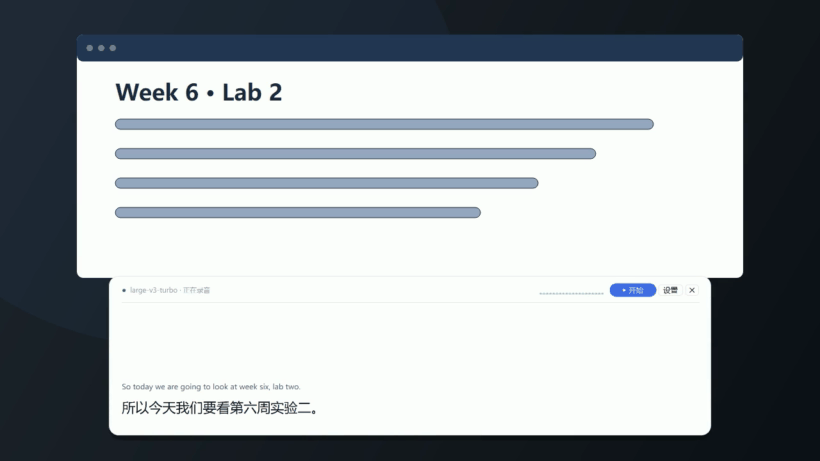

# CaptiNote · 课记

**给英语授课的课堂做一个实时中文字幕浮窗，课后自动出结构化纪要。全程本地运行。**

[](LICENSE)
[]()
[]()
[]()

<p align="center">
  
</p>

<p align="center"><i>老师说什么，几秒内变成中文 · 灰色是草稿，黑色是定稿</i></p>

---

## 先看效果

| 上课时：字幕跟着老师的话滚 | 下课后：结构化纪要 |
|---|---|
|  |  |

---

## 它解决什么

英文授课，老师有口音，一节课下来只记住几个词。
录下来回去听？两小时的录音，不知道该重听哪一段。

CaptiNote 做三件事：

- **实时字幕**：贴在屏幕最上层的浮窗，老师说什么，几秒内出中文
- **草稿 / 定稿双轨**：说话的瞬间先出草稿，说完几秒后用高准确度版本覆盖
- **课后纪要**：标题、摘要、时间轴、要点、待办、本节课术语

## 快速开始

### 方式一：下载便携版（推荐）

1. 到 [Releases](https://github.com/yuluo-zero/captinote/releases/latest) 下载 `CaptiNote-v0.1.0-win64.zip`
2. 解压到任意目录（比如 `D:\CaptiNote`）
3. 双击 `CaptiNote.exe`

**首次启动会自动下载识别模型（约 1.6 GB）**，界面上方会显示提示。看到它在下载，不是卡死了。

配置、录音、模型都保存在 exe 同目录，整个文件夹可以直接搬到别的电脑。

### 方式二：从源码运行

```powershell
git clone https://github.com/yuluo-zero/captinote.git
cd captinote
python -m venv venv
venv\Scripts\python -m pip install -r requirements.txt
venv\Scripts\python overlay.py
```

国内下载模型慢的话，先设镜像：

```powershell
$env:HF_ENDPOINT = "https://hf-mirror.com"
```

---

## 使用

### 【启动】

双击图标，屏幕底部出现字幕浮窗。浮窗常驻最上层，可以拖到任意位置，拖边缘可缩放，松手后自动记住尺寸。

关闭浮窗不会退出——程序缩到托盘，右键托盘图标可以真正退出。

### 【开始听课】

点「▶ 开始」，选择麦克风，字幕开始跟随。

- 灰色小字是**草稿**：老师话还没说完就先给你看个大概
- 黑色大字是**定稿**：几秒后覆盖草稿，是准确的版本
- 绿色圆点会呼吸，表示"正在听，字还在路上"
- 课间想休息，点「暂停」——麦克风会释放，不占用设备

### 【下课】

点「■ 停止」，弹出课后纪要：

- **纪要**：标题、一句话摘要、时间轴、分栏要点、待办、术语
- **原文**：完整双语记录，每句前面有时间戳
- **底部输入框**：就这次记录提问，比如"作业截止是哪天？"

时间轴上的时间、原文里的 `▶ [00:12]` 都可以点，**直接从那一秒播放**。走神十分钟，回来点一下补上。

纪要可以导出 Word / PDF，也可以把本节课的术语一键存进词表。

### 【术语表】

设置 → 术语表，按课程分组。左边写容易听错的，右边写想要的：

```
week six / 第六周
AI / artificial intelligence 人工智能
turbine 风机  blade 叶片  nacelle 机舱
```

**每门课用各自的词表**，别混在一起——同一个词在不同课上意思可能完全不同。

---

## 常见问题

**Q：字幕延迟多久？**
草稿 1–2 秒，定稿约 10 秒。Whisper 在本地想准确就需要长一点的上下文，这是准确率和延迟的取舍。

**Q：录音会上传吗？**
不会。音频、转写、纪要全部存在本机 `recordings/`。只有翻译和总结这一步会把**文字**发给 DeepSeek。

**Q：能完全离线吗？**
可以。设置 → 翻译方式 → 「本地翻译」，之后全程不联网（需要事先放好本地翻译模型）。

**Q：风扇很响怎么办？**
设置里的线程数改成 4。实测 4 线程和 8 线程速度几乎一样（4.2s vs 4.3s），但 CPU 占用减半。再加上 Windows 电源计划把处理器最大状态调到 90%。

**Q：准确率不高？**
先确认分段长度——太短的片段 Whisper 会编台词（详见下方"技术说明"）。然后看麦克风：笔记本内置麦是远场收音，换个百来块的麦提升可能比换模型大。

**Q：说话人分得清吗？**
分不清。没有说话人分离，老师的和同学提问的会混在一起。

**Q：支持别的语言吗？**
目前只做英文课。识别模型和翻译提示词都是围绕英文课堂调的。

---

## 技术说明

### 为什么分段不能太短

同一段课堂录音，只改喂给 Whisper 的片段长度：

| 分段 | 识别结果 |
|---|---|
| 1.5 秒 | `I'll see you next time` / `Thank you`（幻觉） |
| 4 秒 | `I present to you all the best` ×3（幻觉） |
| 8 秒 | `I go and use this. I cut.`（零碎） |
| 10 秒 | `I have number three in room and ask him to come to my desk...` ✅ |

老师真正说的是："明天你把报告带来……我随机抽一个同学到讲台讲报告。"

Whisper 按 30 秒窗口训练，**片段太短它没有上下文，只能编**。这是本地实时字幕最经典的翻车点。

现在的做法是**滑动窗口**：每 5 秒出一句，但每次识别都带上前面 8 秒的音频作为上下文，再用词级时间戳裁掉已经显示过的部分。既保住出字频率，又给模型足够的上下文。

### 双轨是怎么分工的

```
草稿   sherpa-onnx 双语 zipformer（26 倍实时）  →  本地小模型翻译（80ms，不花钱）
定稿   faster-whisper large-v3-turbo int8（约 1.3 倍实时） →  DeepSeek 翻译
```

草稿负责"知道老师在讲什么"，定稿负责"记录是对的"。

### 性能参考

| 项目 | 数字（24 核 CPU，无独显） |
|---|---|
| 识别速度 | 约 1.3 倍实时 |
| 内存 | 约 1.5 GB |
| 模型磁盘 | 1.6 GB |
| 录音 | 90 分钟约 30 MB（转 Opus） |
| 翻译成本 | DeepSeek 约 0.2–0.4 元/节 |

## 项目结构

```
overlay.py          主程序：识别、翻译、界面、纪要（约 2700 行，单文件）
requirements.txt    依赖
config.example.json 配置示例
assets/             截图与封面
```

## 已知限制

- 定稿延迟约 10 秒，草稿层用于弥补
- 没有说话人分离
- 仅支持 Windows
- 单文件、无自动化测试，是能用的原型而非工程化项目
- 麦克风质量决定成败：干净音频准确率接近 100%，远场教室录音会明显下降

## 路线图

- [ ] 说话人分离
- [ ] 跨平台
- [ ] 术语表自动生成与去重
- [ ] 打包体积优化

## 许可

[MIT](LICENSE) · 随便改、随便用、随便发。
