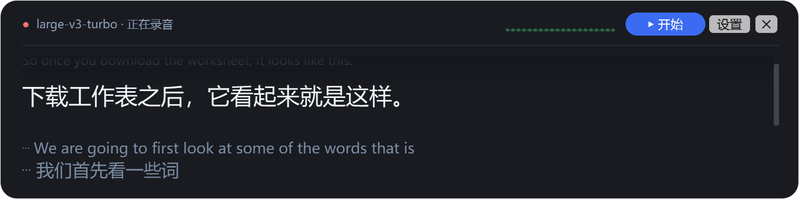
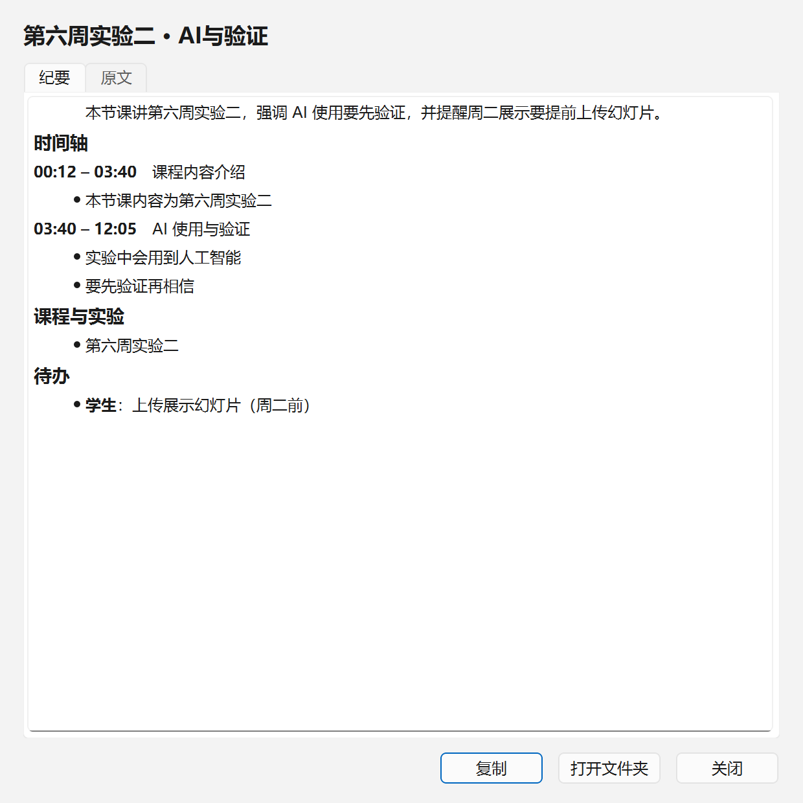
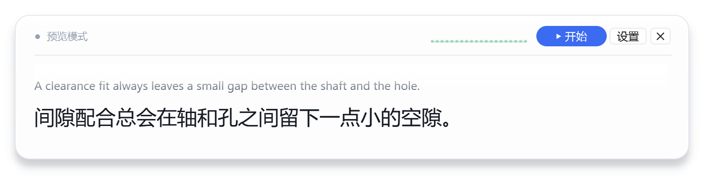

# CaptiNote · 课记

**给英语授课的课堂做一个实时中文字幕浮窗，课后自动出结构化纪要。全程本地运行。**

> 上课听不懂，不应该只能靠录音回去硬啃。

## 它解决什么

留学生在英语授课的课堂上，最常见的三个问题：

1. **跟不上** —— 老师有口音、语速快，一节课下来只记了几个词
2. **来不及记** —— 一边听一边记笔记，两头都做不好
3. **回去听不懂** —— 录音两小时，不知道重听哪一段

CaptiNote 针对这三点：

- **实时字幕浮窗**：贴在屏幕最上层，不挡你看 PPT
- **草稿 / 定稿双轨**：说话的瞬间先出草稿（1–2 秒），说完几秒后用高准确度版本覆盖
- **课后结构化纪要**：标题、一句话摘要、时间轴、分栏要点、待办、术语表
- **点一句话听那一段**：纪要里的时间戳和原文都可以点，直接跳转播放
- **按课程分组的术语表**：把常错的专业词喂给模型，越用越准

## 效果

| 实时字幕（草稿在下、定稿在上） | 课后纪要 |
|---|---|
|  |  |

浅色主题：



## 核心设计

### 草稿 / 定稿双轨

这是它和其他实时字幕工具最不一样的地方。

```
老师说： "So today we are going to look at week six, lab two."

1 秒后  ⋯ So today we are going to look at week six        ← 流式草稿（快，粗糙）
       ⋯ 所以今天我们要看第六周

6 秒后  So today we are going to look at week six, lab two.  ← Whisper 定稿（慢，准确）
       所以今天我们要看第六周实验二。
```

- **草稿**：sherpa-onnx 流式模型（双语 zipformer），26 倍实时速度，本地小翻译模型出中文
- **定稿**：faster-whisper large-v3-turbo（int8 量化）+ DeepSeek 翻译

草稿让你知道"老师正在讲什么"，定稿保证"记录是对的"。

### 为什么分段要 ≥10 秒

实测同一个课堂录音，只改分段长度：

| 分段 | 识别结果 |
|---|---|
| 1.5 秒 | `I'll see you next time` / `Thank you`（幻觉） |
| 4 秒 | `I present to you all the best` ×3（幻觉） |
| 8 秒 | `I go and use this. I cut.`（零碎） |
| **10 秒** | `I have number three in room and ask him to come to my desk and start reading` ✅ |
| 20 秒 | `And ask that guy, which is selected randomly by us, to answer questions about the report` ✅ |

Whisper 是按 30 秒窗口训练的。**片段太短，它没有上下文，只能编。** 这是本地实时字幕最常见的翻车原因。

## 安装

### 环境

- Windows 10 / 11
- Python 3.11 – 3.13（开发用的是 3.14）
- 不需要显卡，纯 CPU 跑

### 步骤

```powershell
git clone https://github.com/<your-name>/captinote.git
cd captinote

python -m venv venv
venv\Scripts\python -m pip install -r requirements.txt
```

首次运行会自动下载 Whisper 模型（约 1.6 GB），需要能访问 huggingface：

```powershell
venv\Scripts\python overlay.py
```

如果想用中文镜像加速：

```powershell
$env:HF_ENDPOINT = "https://hf-mirror.com"
```

### 可选：本地翻译模型（不联网也能翻）

默认用 DeepSeek 翻译（需要 API key）。如果完全不想联网，可以把 ONNX 版 Marian 放到 `models/opus-onnx/`，然后在设置里把翻译方式改成「本地翻译」。

## 使用

1. 点桌面/托盘图标启动，出现字幕浮窗
2. 点「▶ 开始」，选麦克风
3. 上课时浮窗会跟着老师的话滚动
4. 点「■ 停止」，几秒后弹出纪要
5. 纪要里可以导出 Word / PDF，也可以就着记录提问

### 快捷键与小技巧

- 拖窗口边缘缩放，松手即记住尺寸
- 设置里可以锁定窗口大小，防止误拖
- 术语表按课程分组，每门课各存各的

## 配置

第一次运行会在程序目录生成 `config.json`，也可以在设置界面里改。

```json
{
  "model": "large-v3-turbo",
  "threads": 4,
  "translator": "deepseek",
  "api_key": "sk-...",
  "theme": "light",
  "courses": [
    { "name": "风能", "glossary": "week six / 第六周\nlab two / 实验二" }
  ],
  "active_course": "风能"
}
```

- `threads`：CPU 线程数。实测 4 线程和 8 线程速度几乎一样，但占用减半，风扇更安静
- `api_key`：只存在本机 `config.json`，除了调用翻译接口不会发往任何地方

## 性能实测

在你的机器上会不一样，这里给个参考（24 核 CPU，无独显）：

| 项目 | 数字 |
|---|---|
| 识别速度 | 约 1.3 倍实时（10 秒音频约 5 秒算完） |
| 端到端延迟 | 草稿 1–2 秒，定稿 10–16 秒 |
| 内存占用 | 约 1.5 GB（模型加载后） |
| 磁盘占用 | 模型 1.6 GB + 录音每节课约 30 MB |
| 翻译成本 | DeepSeek 约 0.2–0.4 元/节，一学期十几元 |

录音会转成 Opus，90 分钟一节课约 30 MB（WAV 是 170 MB）。

## 已知限制

诚实地说：

- **定稿延迟 10–16 秒**。Whisper 想在本地准确，就需要长片段；这是准确率和延迟的取舍。草稿层是为了弥补这个延迟
- **没有说话人分离**。分不清老师说的还是学生说的
- **只支持 Windows**（用到了 Windows 的托盘、启动文件夹等）
- **单文件、无自动化测试**。`overlay.py` 约 2700 行，是个能跑的原型，不是工程化项目
- **麦克风质量决定成败**。同样的代码，干净音频准确率接近 100%，教室远场录音会明显下降

## 路线图

- [ ] 滑动窗口（带上下文但只显示新增文字）——把定稿延迟从 16 秒降到 5 秒
- [ ] 说话人分离
- [ ] 跨平台
- [ ] 术语表自动生成与去重

## 隐私

- 录音、转写、纪要**全部存在本机** `recordings/` 目录
- 只有翻译和总结会调用 DeepSeek 接口，发出的是文字，不发音频
- 如果切到「本地翻译」，全程不联网
- API key 只写在本地 `config.json`，已被 `.gitignore` 排除

## 许可

MIT
